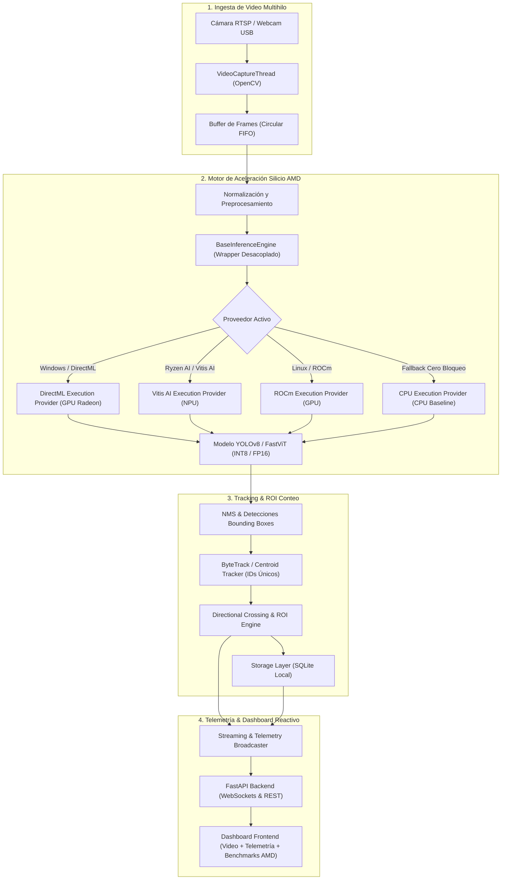
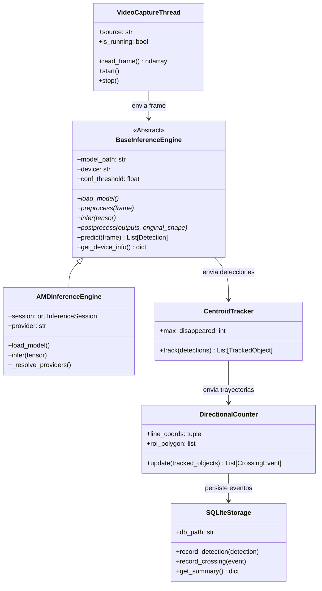

# System Design Document (SDD)
## Bio-Edge AMD • Monitoreo Ecológico & Conteo Inteligente en el Borde

**Hackathon AMD Acto 3**  
**Ventana de Ejecución:** 12 al 18 de Octubre  
**Versión del Documento:** 1.0.0  
**Estado:** Aprobado para Implementación  

---

## 1. Visión General del Sistema y Propuesta de Valor

Los sistemas convencionales de foto-trampeo e investigación biológica en reservas ecológicas almacenan gigabytes de metraje de video pasivo en tarjetas SD locales. Este enfoque obliga al personal de campo a realizar recolecciones físicas de datos periódicas y a procesar la información semanas después en servidores de nube. Esto anula la capacidad de alertar incursiones furtivas en tiempo real o censar dinámicamente especies en peligro de extinción.

**Bio-Edge AMD** es una arquitectura ciberfísica autónoma de borde que ejecuta visión artificial e inferencia neuronal in-situ. Procesa flujos de video localmente con ultra-baja latencia y máxima eficiencia energética por vatio (FPS/Watt), sin depender de conectividad a internet ni saturar la CPU anfitriona.

### 1.1 Metas de Alto Nivel
1. **Inferencia Acelerada por Silicio:** Aprovechar de forma nativa el silicio AMD (NPU Ryzen AI mediante Vitis AI Execution Provider, y GPUs Radeon vía DirectML / ROCm).
2. **Autonomía Operativa en el Borde:** Operación completa sin internet; persistencia embebida ultraligera en SQLite.
3. **Conteo Direccional de Fauna:** Detección y rastreo de fauna e intrusos con identificación de trayectoria (cruce de líneas virtuales o polígonos ROI).
4. **Telemetría y Streaming de Ultra-Baja Latencia:** Streaming en vivo procesado vía WebSocket y API REST con FastAPI a más de 30 FPS.
5. **Resiliencia Operativa Multiplataforma:** Fallback transparente a CPU para permitir desarrollo cruzado en cualquier equipo del equipo.

---

## 2. Arquitectura Global del Sistema

El sistema está estructurado en 4 pilares desacoplados para garantizar modularidad, extensibilidad y resiliencia:

---

## 3. Especificación Detallada de los 4 Pilares

### Pilar 1: Ingesta de Video Multihilo
* **Módulo:** `src/pipeline/video_capture.py`
* **Mecanismo:** Hilo dedicado desacoplado del bucle de inferencia para lectura de buffers RTSP/Webcam sin retrasos acumulativos (`I/O backlog`).
* **Control de Saturación:** Lectura continua con vaciado de frames obsoletos, entregando al pipeline siempre el fotograma más reciente (`drop-oldest queue`).
* **Normalización:** Redimensionamiento y conversión de espacio de color (`RGB/BGR`) optimizada en C++ vía OpenCV.

### Pilar 2: Motor de Aceleración AMD
* **Módulos:** `src/engine/base_engine.py`, `src/engine/inference_amd.py`, `src/engine/benchmark.py`
* **Framework:** ONNX Runtime (`onnxruntime-directml` en Windows, `onnxruntime-vitisai` para Ryzen AI, o `onnxruntime-rocm` en Linux).
* **Modelos Soportados:** Modelos de visión ultralivianos (YOLOv8-nano / FastViT) optimizados para detección de fauna silvestre e intrusos.
* **Cuantización:** 
  - FP16: Para GPU Radeon con núcleos de cómputo FP16 de alta densidad.
  - INT8: Mediante Vitis AI Quantizer / ONNX Runtime Quantization Tools para ejecución en NPU Ryzen AI con retención de precisión calibrada.
* **Mecanismo de Resiliencia:** Si el hardware AMD no está disponible o falla la inicialización de librerías del proveedor, el motor activa automáticamente el `CPUExecutionProvider` sin interrumpir la ejecución ni arrojar excepciones fatales.

### Pilar 3: Tracking & Lógica de Conteo Direccional
* **Módulos:** `src/pipeline/tracker.py`, `src/pipeline/counting.py`, `src/storage/storage.py`
* **Algoritmo de Rastreo:** ByteTrack liviano / Centroid Tracker basado en distancia euclidiana y asociación de intersección sobre unión (IoU) con persistencia temporal de estados (`lost/active`).
* **Lógica de Conteo:** 
  - Línea virtual configurada por coordenadas $(x_1, y_1) \rightarrow (x_2, y_2)$ con detección de producto vectorial para vectorizar dirección (Entrando / Saliendo).
  - Región poligonal de interés (ROI) para áreas de protección estricta.
* **Persistencia Local en Borde:** Base de datos SQLite (`data/bio_edge.db`) con soporte ACID local, registrando eventos de cruce, especies detectadas, nivel de confianza, metadatos temporales y métricas de inferencia.

### Pilar 4: Telemetría, API & Dashboard Reactivo
* **Módulos:** `src/api/main_server.py`, `frontend/`
* **Servidor:** FastAPI con `uvicorn`.
* **Canales de Comunicación:**
  - WebSocket `/ws/stream`: Transmisión de frames JPEG codificados en base64 o binario a 30+ FPS con anotaciones de bounding boxes, trayectorias y IDs.
  - WebSocket `/ws/telemetry`: Transmisión en tiempo real de FPS, latencia por frame (ms), temperatura/carga de hardware, y conteo acumulado de especies.
  - REST API `/api/stats`, `/api/history`, `/api/benchmarks`: Consulta de reportes históricos, cruces por hora y comparativa CPU vs. AMD.
* **Interfaz de Usuario:** Dashboard reactivo interactivo que permite visualizar el stream en directo, alternar entre acelerador AMD y CPU para evidenciar la diferencia de latencia al jurado, y revisar estadísticas biológicas.

---

## 4. KPIs y Métricas Cuantitativas para el Jurado de AMD

| Indicador | Línea Base (CPU Estándar) | Meta con Aceleración AMD | Justificación Técnica |
| :--- | :--- | :--- | :--- |
| **Latencia de Inferencia** | $> 110\text{ ms}$ por frame | **$< 25\text{ ms}$** por frame | Ejecución en hardware dedicado (GPU DirectML / NPU Ryzen AI). |
| **Cadencia de Video** | $8 - 12\text{ FPS}$ | **$> 45\text{ FPS}$** (sostenidos 1080p) | Ingesta multihilo + inferencia concurrente optimizada. |
| **Retención de Precisión** | $100\%$ FP32 | **$\ge 94\%$ mAP@50** (en INT8) | Calibración adecuada con dataset representativo de fauna. |
| **Eficiencia Energética** | Alto consumo térmico CPU | Reducción del uso de CPU $>60\%$ | Descarga de cómputo intensivo hacia la NPU/GPU de bajo consumo. |

---

## 5. Diseño de Componentes e Interfaces

---

## 6. Consideraciones de Seguridad y Robustez en el Borde

1. **Reconexión Automática de Video:** El hilo de captura detecta pérdida de señal RTSP o desconexión física de webcam, reintentando la conexión cada 2 segundos sin congelar la interfaz.
2. **Backpressure & Memory Leak Protection:** Se utiliza un buffer de un solo frame (`LIFO/drop-oldest`) para garantizar que la memoria RAM se mantenga constante sin fugas en ejecuciones prolongadas de 24/7.
3. **Persistencia Transaccional Protegida:** SQLite opera en modo WAL (`Write-Ahead Logging`) para asegurar que un corte abrupto de energía en campo no corrompa el archivo de base de datos.
4. **Desacoplamiento Absoluto:** El servidor web y el frontend pueden reiniciarse de forma independiente sin detener el procesamiento de borde en segundo plano.
